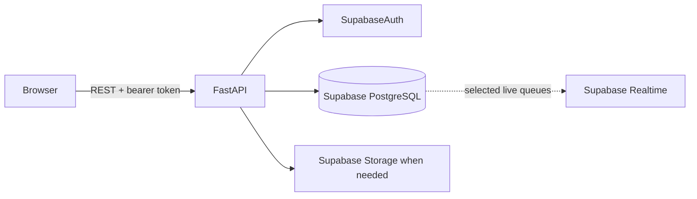
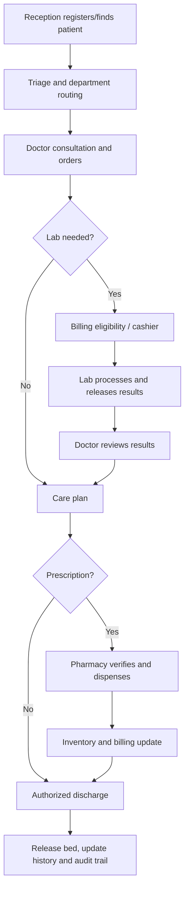

# NexusCare Architecture

**Official title:** Development of an Integrated Hospital Information and Resource Management System

## Architecture

The browser must call hospital business endpoints through FastAPI. FastAPI verifies Supabase Auth access tokens and enforces authorization. Never expose a service-role key, database password, or signing secret in frontend code. The selected Python supabase-py approach is retained for backend Supabase operations; SQLAlchemy 2 and Alembic remain in the dependency baseline for schema modeling and migrations. Review this mixed access approach and all RLS policies before production.

## Database model foundation (Phase 2)

| Domain | Tables |
|---|---|
| Identity | profiles, roles, user_roles, departments |
| Patients and beds | patients, admissions, wards, beds, ward_transfers |
| Clinical | encounters, consultations, vital_signs, diagnoses, consultation_notes, nursing_notes, emergency_events |
| Laboratory | laboratory_tests, laboratory_orders, laboratory_results |
| Pharmacy and stock | medicines, medicine_batches, prescriptions, prescription_items, pharmacy_dispensing, inventory_items, inventory_item_transactions, inventory_transactions, suppliers |
| Finance | service_catalog, bills, bill_items, payments, payment_allocations, receipts |
| Operations | appointments, online_consultations, notifications, audit_logs, system_settings, doctor_schedules |

Use UUID keys, UTC timestamps, foreign keys, indexes, constraints, and normalized relationships. A patient has many encounters/admissions/appointments/bills. Encounters connect consultations, diagnoses, vitals, lab orders, and prescriptions. Admissions reference wards/beds; transfers and discharge update availability atomically. Bills contain items and may have multiple payments. Profiles connect Supabase identities to roles and departments.

Integrity: exact numeric money amounts; no silent deletion of posted payments/receipts; auditable reversals/refunds; payment idempotency; no negative stock; no overlapping active bed assignments; server-validated transitions; fictional seed data only.

## Workflow

## API plan and current status

All routes are under /api/v1, use Pydantic validation, and enforce authentication/role/scope checks.

| Domain | Planned routes |
|---|---|
| Identity | GET /auth/me, GET /profiles/me |
| Patients | GET/POST /patients, GET/PATCH /patients/{id} |
| Admissions | GET/POST /admissions, POST /admissions/{id}/transfer, POST /admissions/{id}/discharge |
| Clinical | GET/POST /encounters, POST /encounters/{id}/consultations, POST /encounters/{id}/vitals |
| Lab | GET/POST /laboratory/orders, POST /laboratory/orders/{id}/results, POST /laboratory/orders/{id}/release |
| Pharmacy | GET/POST /prescriptions, POST /prescriptions/{id}/dispense |
| Finance | GET/POST /bills, POST /bills/{id}/payments, GET /receipts/{id} |
| Resources | GET/POST /inventory/items, POST /inventory/items/{id}/transactions |
| Operations | GET/POST /appointments, GET /notifications, GET /dashboard |
| Governance | GET /reports, GET /audit-logs |

Implemented in Phase 2: GET /api/v1/auth/me and GET /api/v1/admin/access-check (administrator role required), in addition to the health endpoint. Patient, admission, clinical, laboratory, pharmacy, finance, inventory and operations endpoints remain planned and are not implemented yet.

## Roadmap
1. Architecture/setup, design system, responsive sidebar.
2. Models/migrations, Auth verification, RBAC, RLS, fictional seeds.
3. Patients, admissions, wards, beds.
4. Consultations, nursing, ER, laboratory, prescriptions.
5. Fees, billing, payments, receipts, pharmacy, inventory.
6. Appointments, online consultation, notifications, whiteboard, reports, settings.
7. Integration, security and end-to-end testing.
8. Deployment preparation and documentation.
